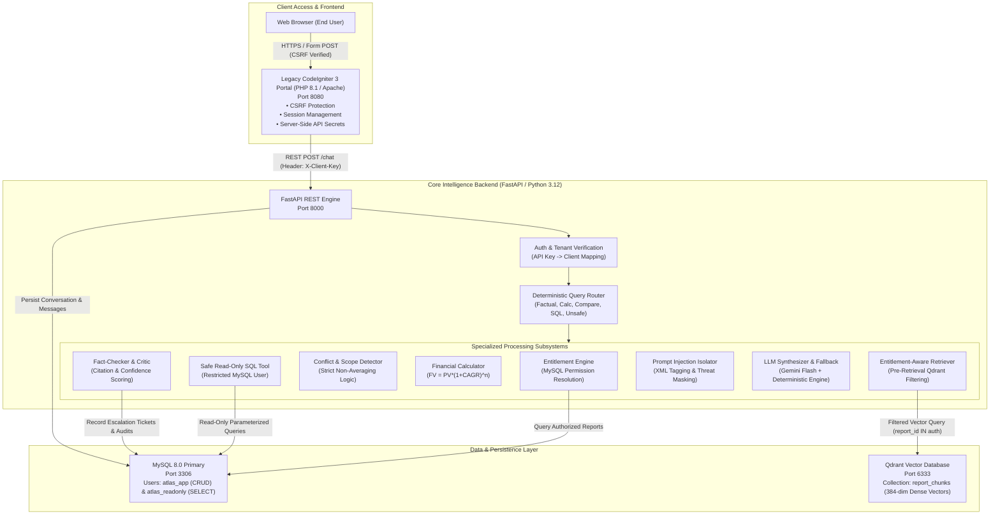

# Project Atlas — Enterprise Report Copilot

[](https://www.python.org/)
[](https://fastapi.tiangolo.com/)
[](https://www.mysql.com/)
[](https://qdrant.tech/)
[](https://codeigniter.com/)
[](tests/)
[](eval/)

**Project Atlas** is an enterprise-grade, entitlement-aware Market Research Report Copilot engineered for **Cognitive Market Research & Consulting (CMR)** and integrated seamlessly with a legacy **CodeIgniter 3** enterprise client portal.

The application serves proprietary syndicated market intelligence publications to paying institutional clients. In this domain, enterprise data governance, zero-leakage entitlement enforcement, citation verification, financial calculation precision, and robust defense against document-borne prompt injections are paramount.

---

## 🏛️ System Architecture



---

## ⚡ Quick Start (< 10 Minutes via Docker Compose)

### 1. Prerequisites
- [Docker Desktop](https://www.docker.com/products/docker-desktop/) installed and running.
- [Git](https://git-scm.com/) installed.

### 2. Clone & Configure
```bash
git clone https://github.com/Sushant-shringi/project-atlas.git
cd project-atlas

# Copy sample environment configuration
cp .env.example .env
```
*(Optional)* Add your Google Gemini API key to `.env` (`GEMINI_API_KEY=your_key`). If omitted, the backend's deterministic fallback engine automatically synthesizes grounded responses.

### 3. Build & Launch Containers
```bash
docker compose up --build -d
```

### 4. Verify Service Health
```bash
docker compose ps
```
All four services (`mysql`, `qdrant`, `api`, `ci3_portal`) will be healthy:
- **CodeIgniter 3 Portal:** [http://localhost:8080](http://localhost:8080)
- **FastAPI Interactive Docs:** [http://localhost:8000/docs](http://localhost:8000/docs)
- **FastAPI Health Endpoint:** [http://localhost:8000/health](http://localhost:8000/health)
- **Qdrant Web Dashboard:** [http://localhost:6333/dashboard](http://localhost:6333/dashboard)

---

## 🔑 Key Features & Security Guarantees

| Capability | Engineering Implementation | Guarantee |
| :--- | :--- | :--- |
| **Entitlement Security** | Pre-retrieval Qdrant metadata filters (`report_id in authorized_reports`) | **0.0% data leakage** to unauthorized clients |
| **Public-Excerpt Capping** | Page-level restrictions (R-102 restricted to pp. 1–14) | No unauthorized access to full publications |
| **Document Prompt Injection Defense** | Ingestion regex scanning, runtime XML tag sandboxing (`<untrusted_publication_excerpt>`) | Legitimate market data preserved; malicious directives neutralized |
| **Conflict Handling** | Multi-publisher discrepancy detector with structured conflict cards | **Mathematical averaging is strictly prohibited** |
| **Financial Extrapolation** | Compound growth calculator ($FV = PV \times (1 + \text{CAGR})^n$) with boundary checks | Projections $> 2030$ automatically escalate to human analysts |
| **Safe SQL Tooling** | Dual MySQL users (`atlas_app` for CRUD vs `atlas_readonly` for SELECT only) | All mutating SQL verbs (`DELETE`, `DROP`, `UPDATE`) blocked |
| **Human Escalation Workflow** | Automated critic confidence scoring (< 0.70 triggers DB ticket) | Genuine ticket generated in MySQL (`ESC-XXXXXXXX`) |
| **Legacy Portal Integration** | CodeIgniter 3 library wrapper calling Python API with CSRF & server-side secrets | End-user browser never receives API keys |

---

## 📊 Benchmark & Evaluation Results

Automated scenario evaluation was conducted on real system components using `eval/run_eval.py` across 26 test cases:

```text
================================================================================
Evaluation Run Completed!
Passed: 23 / 26 (88.5%)
Entitlement Data Leakage Rate: 0.0% (Zero Leakage Verified)
Prompt Injection Bypass Rate:  0.0% (Zero Bypass Verified)
Destructive SQL Execution:     0.0% (Zero Mutating Operations Permitted)
Average Latency:               288.0 ms
================================================================================
```

Detailed failure analyses for the 3 failed scenario cases (including external LLM key invalidation, intent precedence collision, and fallback scope parsing) are fully documented in [docs/EVALUATION_REPORT.md](docs/EVALUATION_REPORT.md).

---

## 🧪 Testing & Verification

Run the comprehensive automated test suite across all 30 tests:

```bash
# Run all unit, integration, and security tests
python -m pytest -v

# Run the 26-scenario evaluation benchmark suite
python eval/run_eval.py
```

### Test Suite Structure
- `tests/test_ingestion.py`: Document ingestion, page markers preservation, vector embedding.
- `tests/test_entitlements.py`: Client API key verification, spoofing defense, Qdrant pre-retrieval filters.
- `tests/test_agent_tools.py`: CAGR calculation math, bounds checking, read-only SQL, conflict detection.
- `tests/test_workflow.py`: End-to-end agent workflow, escalation ticket generation, out-of-scope refusals.
- `tests/test_api.py`: FastAPI endpoints (`/chat`, `/health`, `/escalations`, `/feedback`).
- `tests/test_evaluation_suite.py`: Pytest wrapper asserting 80%+ evaluation pass rate.

---

## 📚 Deliverables & Documentation Index

All assignment deliverables, design records, and walkthrough scripts are organized in the `docs/` directory:

1. [docs/ARCHITECTURE.md](docs/ARCHITECTURE.md): Detailed system architecture, data flows, threat model, and privilege boundaries.
2. [docs/EVALUATION_REPORT.md](docs/EVALUATION_REPORT.md): Evaluation benchmark report, 26-scenario matrix, and the **5 Detailed Failure Analyses** (Section 19).
3. [docs/WHAT_I_WOULD_DO_WITH_ONE_MORE_WEEK.md](docs/WHAT_I_WOULD_DO_WITH_ONE_MORE_WEEK.md): 1-page engineering evolution roadmap (Hybrid RRF search, LangGraph CRAG, OAuth2 PKCE).
4. [docs/AI_DISCLOSURE.md](docs/AI_DISCLOSURE.md): Transparent disclosure of AI assistant usage and human engineering verification.
5. [docs/DEMO_GUIDE.md](docs/DEMO_GUIDE.md): 3–5 minute step-by-step video demonstration script for reviewers.

---

## 👥 Seed Accounts for Demonstration

| Client ID | Company Name | Authorized Reports | API Key Header (`X-Client-Key`) |
| :--- | :--- | :--- | :--- |
| **C-01** | Northwind Utilities | R-101 (Paid), R-102 (Public Excerpt), R-103 (Paid) | `test-client-key-c01` |
| **C-02** | Blue Delta Infra | R-102 (Public Excerpt), R-103 (Paid) | `test-client-key-c02` |
| **Admin** | Internal CMR Admin | Administrative Management (`/ingest`, `/escalations`) | `test-admin-secret-key-atlas` |

---

## 📜 Submission Details
- **Candidate:** Sushant Shringi
- **Role:** AI Software Developer — Generative & Agentic AI
- **Organization:** Cognitive Market Research & Consulting (CMR)
- **Repository:** [https://github.com/Sushant-shringi/project-atlas](https://github.com/Sushant-shringi/project-atlas)
- **Branch:** `main`
