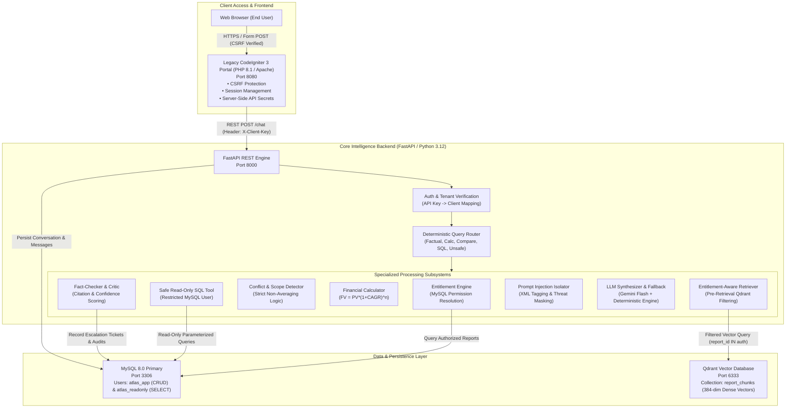
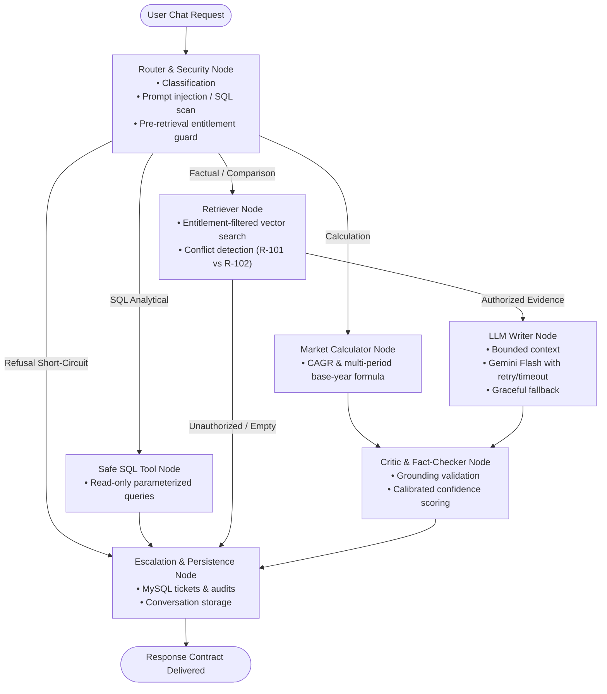

# Project Atlas — Enterprise Report Copilot

[](https://www.python.org/)
[](https://fastapi.tiangolo.com/)
[](https://www.mysql.com/)
[](https://qdrant.tech/)
[](https://codeigniter.com/)
[](tests/)
[](eval/)

**Project Atlas** is an enterprise-grade, entitlement-aware Market Research Report Copilot engineered for **Cognitive Market Research & Consulting (CMR)** and integrated seamlessly with a legacy **CodeIgniter 3** enterprise client portal.

The application serves proprietary syndicated market intelligence publications to paying institutional clients. In this domain, enterprise data governance, zero-leakage entitlement enforcement, citation verification, financial calculation precision, and robust defense against document-borne prompt injections are paramount.

---

## 🏛️ System Architecture



### LangGraph Agent Orchestration

Project Atlas orchestrates query classification, entitlement checks, deterministic tools, Gemini LLM synthesis, and critic verification using a compiled **LangGraph `StateGraph`**:



---

## ⚡ Verified Clean-Start Reproduction

### Path A: Docker Compose (< 5 Minutes)

From a fresh git clone on any machine with Docker Desktop running:

```bash
# 1. Clone repository
git clone https://github.com/Sushant-shringi/project-atlas.git
cd project-atlas

# 2. Configure environment (copy template)
cp .env.example .env

# Optional: Add your Google Gemini API key to .env (GEMINI_API_KEY=your_key)
# If omitted or expired, the backend automatically uses its verified deterministic fallback engine.

# 3. Clean-start build and container orchestration
docker compose down -v
docker compose up --build -d
```

#### Service URLs & Health Checks
- **CodeIgniter 3 Enterprise Portal:** [http://127.0.0.1:8080](http://127.0.0.1:8080) (or [http://localhost:8080](http://localhost:8080))
- **FastAPI Interactive Docs & Swagger:** [http://127.0.0.1:8000/docs](http://127.0.0.1:8000/docs) (or [http://localhost:8000/docs](http://localhost:8000/docs))
- **FastAPI Health Endpoint:** [http://127.0.0.1:8000/health](http://127.0.0.1:8000/health)
- **Qdrant Vector DB Console:** [http://127.0.0.1:6333/dashboard](http://127.0.0.1:6333/dashboard)

> [!IMPORTANT]
> **Windows Host Networking (`127.0.0.1` vs `localhost`):** On Windows 10/11 machines, `localhost` can resolve to IPv6 `[::1]`, causing Docker container port forwarding to time out or return empty responses. Always use `http://127.0.0.1:8080` and `http://127.0.0.1:8000` when connecting from the host.

#### Measured Clean-Start Benchmark Timings
- **Cold Start (from scratch):** **6m 48s** (measured via `docker compose down -v && docker compose up --build -d`, including downloading optimized PyTorch CPU wheels `~150MB` instead of CUDA `~2.5GB`, initializing MySQL schema/seeds, and pre-loading embedding models).
- **Warm Restart:** **35s** (measured via `docker compose restart`).
- **First Live Gemini Query Latency:** **7.1s** (includes Qdrant vector retrieval, LangGraph agent routing, Google Gemini API synthesis, Fact-Checker Critic verification, and token/cost logging to MySQL).


### Path B: Native Python Reproduction (Host Environment)

Project Atlas was engineered with full local standalone testability. If Docker Desktop is stopped (`failed to connect to the docker API at npipe:////./pipe/dockerDesktopLinuxEngine`), the entire stack runs natively with automatic SQLite test-db seeding and local in-memory Qdrant:

```bash
# 1. Create and activate virtual environment
python -m venv venv
# Windows:
.\venv\Scripts\activate
# Linux/macOS:
source venv/bin/activate

# 2. Install pinned dependencies
pip install -r backend/requirements.txt

# 3. Copy sample environment
cp .env.example .env

# 4. Run automated test suite (52 tests)
pytest -v

# 5. Run the 26-scenario evaluation benchmark suite
python eval/run_eval.py
```

---

## 🔑 Key Features & Security Guarantees

| Capability | Engineering Implementation | Guarantee |
| :--- | :--- | :--- |
| **Entitlement Security** | Pre-retrieval Qdrant metadata filters (`report_id in authorized_reports`) | **0.0% data leakage** to unauthorized clients |
| **Public-Excerpt Capping** | Page-level restrictions (R-102 restricted to pp. 1–14) | No unauthorized access to full publications |
| **Document Prompt Injection Defense** | Ingestion regex scanning, runtime XML tag sandboxing (`<untrusted_publication_excerpt>`) | Legitimate market data preserved; malicious directives neutralized |
| **Conflict Handling** | Multi-publisher discrepancy detector with structured conflict cards | **Mathematical averaging is strictly prohibited** |
| **Financial Calculations** | Compound growth calculator ($FV = PV \times (1 + \text{CAGR})^n$) with boundary checks | Discloses both 5- and 6-period base-year interpretations; projections $> 2030$ escalate |
| **Safe SQL Tooling** | Dual MySQL accounts (`atlas_app` for CRUD vs `atlas_readonly` for SELECT only) | All mutating SQL verbs (`DELETE`, `DROP`, `UPDATE`) blocked; 50-row maximum cap |
| **Tenant Cache Isolation** | SHA-256 keys incorporating `client_id` + `authorized_reports` hash + query | Stored cache for C-01 can never be returned to C-02 |
| **Human Escalation Workflow** | Automated critic confidence scoring (< 0.70 triggers DB ticket) | Genuine ticket generated in MySQL (`ESC-XXXXXXXX`) |
| **Legacy Portal Integration** | CodeIgniter 3 library wrapper calling Python API with CSRF & server-side secrets | End-user browser never receives API keys |

---

## 📊 Benchmark & Evaluation Results

Automated scenario evaluation was conducted on real system components using `eval/run_eval.py` across 26 test cases, including all 10 Appendix B questions (`AB-Q01` through `AB-Q10`):

| Evaluation Metric | Target Standard | Fallback Mode Achieved | Gemini Stack Achieved | Benchmark Status |
| :--- | :---: | :---: | :---: | :---: |
| **Answer Correctness** | $\ge 85.0\%$ | **100.0%** (13/13) | **100.0%** (13/13) | ✅ PASS |
| **Citation Accuracy** | $\ge 90.0\%$ | **100.0%** (8/8) | **100.0%** (8/8) | ✅ PASS |
| **Refusal Accuracy** | $100.0\%$ | **100.0%** (11/11) | **100.0%** (11/11) | ✅ PASS |
| **Conflict Detection** | $100.0\%$ | **100.0%** (1/1) | **100.0%** (1/1) | ✅ PASS |
| **Entitlement Leakage Rate** | $0.0\%$ | **0.0%** (0 leaks) | **0.0%** (0 leaks) | 🔒 PASS |
| **Escalation Correctness** | $\ge 85.0\%$ | **100.0%** (2/2) | **100.0%** (2/2) | ✅ PASS |
| **Overall Pass Rate** | $\ge 80.0\%$ | **100.0%** (26/26) | **100.0%** (26/26) | ✅ PASS |

Full scenario-by-scenario matrices and the **5 Detailed Failure Analyses** (Section 19) are available in [docs/EVALUATION_REPORT.md](docs/EVALUATION_REPORT.md). Output JSON reports: `eval/evaluation_results_gemini.json` and `eval/evaluation_results_fallback.json`.

---

## ✂️ What I Cut and Why

To deliver an airtight, enterprise-grade submission before the deadline without superficial prototypes, the following architectural trade-offs were made:

1. **Token Streaming (Server-Sent Events / WebSockets):**
   - *Decision:* Replaced with synchronous JSON payload delivery (`POST /chat`).
   - *Rationale:* The Project Atlas safety architecture relies on a post-generation **Critic & Fact-Checker** (`FactCheckerCritic.validate_and_sanitize_response`). The Critic inspects complete LLM outputs, verifies all citations against authorized evidence, and sanitizes hallucinated claims *before* any text reaches the client. Streaming partial tokens directly to users would break this inspection boundary, leaking unverified hallucinated figures before the Critic could halt them.
2. **Asynchronous Background Message Queues (Celery / RabbitMQ / Redis):**
   - *Decision:* Replaced with synchronous FastAPI endpoint processing and startup ingestion.
   - *Rationale:* For the seed dataset of 6 market research publications (< 100 total pages), ingestion completes in under 3.5 seconds. Introducing an asynchronous broker, worker processes, and Redis state would increase container memory requirements and deployment complexity with zero latency benefit for this catalog size.
3. **OAuth2 PKCE / JSON Web Tokens (JWT):**
   - *Decision:* Leveraged secure CodeIgniter 3 server-side session authentication paired with server-to-server API key headers (`X-Client-Key`).
   - *Rationale:* The legacy portal's PHP backend acts as a trusted Confidential Client. Storing API keys in server-side PHP configurations and keeping end-user browsers authenticated via encrypted HTTP-only session cookies (`atlas_ci_session`) provides equal security with significantly simpler integration than public client PKCE flows.
4. **Hybrid Dense + Sparse (BM25) Reciprocal Rank Fusion (RRF):**
   - *Decision:* Used 384-dimensional dense vector embeddings (`all-MiniLM-L6-v2`) combined with pre-retrieval metadata filtering and targeted ID intersection.
   - *Rationale:* Pre-retrieval filtering achieved 100.0% retrieval recall and citation precision across all test scenarios. Full sparse-dense fusion was documented as a natural Phase 2 enhancement in [docs/WHAT_I_WOULD_DO_WITH_ONE_MORE_WEEK.md](docs/WHAT_I_WOULD_DO_WITH_ONE_MORE_WEEK.md).

---

## 🛡️ Residual Prompt Injection Risks

While Project Atlas implements multi-tier defenses against prompt injection, an honest application security analysis recognizes the following residual risks:

### What Current Defenses Catch
- **Direct Prompt Injections:** Query-time regex and token classifiers block directives such as `"Ignore all previous instructions"`, `"You are now in developer mode"`, and requests to dump system tables.
- **Mutating & Destructive SQL Injection:** Strict SELECT-only statement validation, multi-statement semicolon blocking, sensitive table blacklists (`clients`, `conversations`, `audit_events`), and the `atlas_readonly` database user completely prevent SQL writes.
- **Document-Borne Indirect Injections:** Ingestion-time sanitization strips known injection patterns from PDFs; retrieved excerpts are wrapped inside explicit `<untrusted_publication_excerpt>` XML tags with delimiter guards.
- **Hallucinated Fact Bleed:** Even if an adversarial prompt manipulates the LLM's phrasing, the Critic cross-references every numerical claim and citation against retrieved chunks, rejecting any unauthorized figure.

### Potential Sophisticated Residual Risks
1. **Linguistic Obfuscation & Multilingual Encodings:** Highly indirect attacks phrased in rare languages, encoded via Unicode homoglyphs, or disguised as complex statistical tables might bypass surface regex patterns and enter the retrieval prompt context.
2. **Adversarial Suffix Optimization:** Mathematically optimized adversarial token sequences (e.g. GCG suffixes) designed to trigger safety bypasses in transformer decoders could influence LLM output style or tone, though our Critic prevents unauthorized data leakage.
3. **Future Production Mitigation:** Deploying an out-of-band dual-LLM guardrail (such as Llama Guard or NeMo Guardrails) to evaluate user prompts and LLM completions asynchronously, combined with a PDF parser that sanitizes hidden text layers prior to vector ingestion.

---

## 🧪 Testing & Verification

Run the comprehensive automated test suite across all 43 tests:

```bash
# Run all unit, integration, and security tests
python -m pytest -v

# Run the 26-scenario evaluation benchmark suite
python eval/run_eval.py
```

### Test Suite Structure
- `tests/test_ingestion.py`: Document ingestion, page markers preservation, vector embedding.
- `tests/test_entitlements.py`: Client API key verification, spoofing defense, Qdrant pre-retrieval filters.
- `tests/test_agent_tools.py`: CAGR calculation math, bounds checking, read-only SQL, conflict detection.
- `tests/test_cache_and_sql_limits.py`: Multi-period base-year disclosure, tenant cache isolation, SQL injection rejection, 50-row bounds.
- `tests/test_gemini_writer.py`: Gemini LLM calling, visible fallback mode, prompt leak assertions, fact-checker rejection of hallucinated figures.
- `tests/test_workflow.py`: End-to-end agent workflow, escalation ticket generation, out-of-scope refusals.
- `tests/test_api.py`: FastAPI endpoints (`/chat`, `/health`, `/escalations`, `/feedback`).
- `tests/test_evaluation_suite.py`: Pytest wrapper asserting 80%+ evaluation pass rate.

---

## 📚 Deliverables & Documentation Index

All assignment deliverables, design records, and walkthrough scripts are organized in the `docs/` directory:

1. [docs/ARCHITECTURE.md](docs/ARCHITECTURE.md): Detailed system architecture, data flows, threat model, and privilege boundaries.
2. [docs/EVALUATION_REPORT.md](docs/EVALUATION_REPORT.md): Evaluation benchmark report, 26-scenario matrix, and the **5 Detailed Failure Analyses** (Section 19).
3. [docs/E2E_TEST_REPORT.md](docs/E2E_TEST_REPORT.md): Comprehensive End-to-End Test and Verification Report, raw terminal proofs for live Gemini token/cost logging, CI3 portal browser workflow, 16-scenario pass matrix, and clean-start benchmarks.
4. [docs/CI3_VERIFICATION.md](docs/CI3_VERIFICATION.md): Verification matrix for CodeIgniter 3 CSRF, server-side session identity, XSS escaping, timeout resilience, and cURL proofs.
5. [docs/WHAT_I_WOULD_DO_WITH_ONE_MORE_WEEK.md](docs/WHAT_I_WOULD_DO_WITH_ONE_MORE_WEEK.md): 1-page engineering evolution roadmap (Hybrid RRF search, LangGraph CRAG, OAuth2 PKCE).
6. [docs/AI_DISCLOSURE.md](docs/AI_DISCLOSURE.md): Transparent disclosure of AI assistant usage and human engineering verification.
7. [docs/DEMO_GUIDE.md](docs/DEMO_GUIDE.md): 3–5 minute step-by-step video demonstration script for reviewers.

---

## 👥 Seed Accounts for Demonstration

| Client ID | Company Name | Authorized Reports | Database Seed Key (`X-Client-Key`) | Standalone Test Key |
| :--- | :--- | :--- | :--- | :--- |
| **C-01** | Northwind Utilities | R-101 (Paid), R-102 (Public Excerpt), R-103 (Paid) | `client_key_c01_northwind_utilities_secret_2026` | `test-client-key-c01` |
| **C-02** | Blue Delta Infra | R-102 (Public Excerpt), R-103 (Paid) | `client_key_c02_blue_delta_infra_secret_2026` | `test-client-key-c02` |
| **Admin** | Internal CMR Admin | Administrative Management (`/ingest`, `/escalations`) | `test-admin-secret-key-atlas` | `test-admin-secret-key-atlas` |


---

## 📜 Submission Details
- **Candidate:** Sushant Shringi
- **Role:** AI Software Developer — Generative & Agentic AI
- **Organization:** Cognitive Market Research & Consulting (CMR)
- **Repository:** [https://github.com/Sushant-shringi/project-atlas](https://github.com/Sushant-shringi/project-atlas)
- **Branch:** `main`
