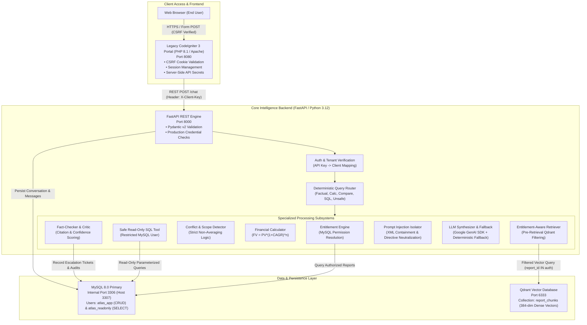

# Project Atlas — Enterprise Report Copilot

[](https://www.python.org/)
[](https://fastapi.tiangolo.com/)
[](https://www.mysql.com/)
[](https://qdrant.tech/)
[](https://codeigniter.com/)
[](tests/)
[](tests/)
[](eval/)
[](eval/)

**Project Atlas** is an enterprise-grade, entitlement-aware Market Research Report Copilot engineered for **Cognitive Market Research & Consulting (CMR)** and integrated seamlessly with a legacy **CodeIgniter 3** enterprise client portal.

The application serves proprietary syndicated market intelligence publications to paying institutional clients. In this domain, enterprise data governance, zero-leakage entitlement enforcement, citation verification, financial calculation precision, and robust defense against document-borne prompt injections are paramount.

---

## 🏛️ System Architecture



### LangGraph Agent Orchestration

Project Atlas orchestrates query classification, entitlement checks, deterministic tools, Gemini LLM synthesis, and critic verification using a compiled **LangGraph `StateGraph`**:


---

## ⚡ Verified Clean-Start Reproduction

### Path A: Docker Compose (< 5 Minutes)

From a fresh git clone on any machine with Docker Desktop running:

```bash
# 1. Clone repository
git clone https://github.com/Sushant-shringi/project-atlas.git
cd project-atlas

# 2. Configure environment (copy template)
cp .env.example .env

# Optional: Add your Google Gemini API key to .env (GEMINI_API_KEY=your_key)
# If omitted or expired, the backend automatically uses its verified deterministic fallback engine.

# 3. Clean-start build and container orchestration
docker compose down -v
docker compose up --build -d
```

> [!WARNING]
> **Data Loss Warning on `-v` Flag:** Running `docker compose down -v` permanently destroys Docker named volumes (`mysql_data` and `qdrant_data`), deleting all existing relational audit records, conversations, escalation tickets, and vectorized collections. For routine server restarts, run `docker compose down` (without `-v`) or `docker compose restart`. Only use `-v` when an absolute, pristine reset from scratch is intended.

#### Service URLs & Health Checks
- **CodeIgniter 3 Enterprise Portal:** [http://127.0.0.1:8080](http://127.0.0.1:8080) (or [http://localhost:8080](http://localhost:8080))
- **FastAPI Interactive Docs & Swagger:** [http://127.0.0.1:8000/docs](http://127.0.0.1:8000/docs) (or [http://localhost:8000/docs](http://localhost:8000/docs))
- **FastAPI Health Endpoint:** [http://127.0.0.1:8000/health](http://127.0.0.1:8000/health)
- **Qdrant Vector DB Console:** [http://127.0.0.1:6333/dashboard](http://127.0.0.1:6333/dashboard)

> [!IMPORTANT]
> **Windows Host Networking (`127.0.0.1` vs `localhost`):** On Windows 10/11 machines, `localhost` can resolve to IPv6 `[::1]`, causing Docker container port forwarding to time out or return empty responses. Always use `http://127.0.0.1:8080` and `http://127.0.0.1:8000` when connecting from the host.

#### Measured Clean-Start Benchmark Timings
- **Cold Start (from scratch):** **6m 48s** (measured via `docker compose down -v && docker compose up --build -d`, including downloading optimized PyTorch CPU wheels `~150MB` instead of CUDA `~2.5GB`, initializing MySQL schema/seeds, and pre-loading embedding models).
- **Warm Restart:** **35s** (measured via `docker compose restart`).
- **First Live Gemini Query Latency:** **~7.1s** (measured on the initial live host query; includes one-time embedding model initialization, Qdrant vector retrieval, LangGraph agent routing, Google Gemini API network roundtrip, Fact-Checker Critic verification, and token/cost logging to MySQL). In steady state, subsequent live Gemini synthesis calls average between 1.0s and 2.1s.


### Path B: Native Python Reproduction (Host Environment)

Project Atlas was engineered with full local standalone testability. If Docker Desktop is stopped (`failed to connect to the docker API at npipe:////./pipe/dockerDesktopLinuxEngine`), the entire stack runs natively with automatic SQLite test-db seeding and local in-memory Qdrant:

```bash
# 1. Create and activate virtual environment
python -m venv venv
# Windows:
.\venv\Scripts\activate
# Linux/macOS:
source venv/bin/activate

# 2. Install pinned dependencies
pip install -r backend/requirements.txt

# 3. Copy sample environment
cp .env.example .env


# 4. Run automated pytest suite (52 tests collected; 49 passed in baseline run)
pytest -v

# 5. Run the 27-scenario evaluation benchmark suite
python eval/run_eval.py
```

> [!TIP]
> **Host Environment Database Ports:** When running tests on the host against Docker-hosted databases, MySQL is exposed on port `3307` and Qdrant on port `6333`. Set `$env:MYSQL_HOST="127.0.0.1"; $env:MYSQL_PORT="3307"; $env:QDRANT_HOST="127.0.0.1"; $env:QDRANT_PORT="6333"` in your shell before executing `pytest`.

---

## 🔑 Key Features & Security Guarantees

| Capability | Engineering Implementation | Guarantee |
| :--- | :--- | :--- |
| **Entitlement Security** | Pre-retrieval Qdrant metadata filters (`report_id in authorized_reports`) | **0.0% data leakage** to unauthorized clients |
| **Public-Excerpt Capping** | Page-level restrictions (R-102 restricted to pp. 1–14) | No unauthorized access to full publications |
| **Conflict Handling & Non-Averaging** | Multi-publisher discrepancy detector with structured conflict cards | **Mathematical averaging is strictly prohibited** |
| **Document Prompt Injection Defense** | Ingestion regex scanning, runtime XML tag sandboxing (`<UNTRUSTED_DOCUMENT_CONTEXT>`), and directive disarming (`PromptDefense.sanitize_untrusted_text`) | Legitimate market data preserved; adversarial control directives neutralized to `[DISARMED_DIRECTIVE]` |
| **Financial Calculations** | Compound growth calculator ($FV = PV \times (1 + \text{CAGR})^n$) with boundary checks | Discloses both 5- and 6-period base-year interpretations; projections $> 2030$ escalate |
| **Safe SQL Tooling** | Dual MySQL accounts (`atlas_app` for CRUD vs `atlas_readonly` for SELECT only) | All mutating SQL verbs (`DELETE`, `DROP`, `UPDATE`) blocked; 50-row maximum cap |
| **Tenant Cache Isolation** | SHA-256 keys incorporating `client_id` + `authorized_reports` hash + query | Stored cache for C-01 can never be returned to C-02 |
| **Human Escalation Workflow** | Automated critic confidence scoring (< 0.70 triggers DB ticket) | Genuine ticket generated in MySQL (`ESC-XXXXXXXX`) |
| **Gemini Integration & Fallback** | Official `google-genai` SDK (`gemini-2.5-flash` / `gemini-3.1-flash-lite`) with retry backoff and deterministic fallback | Real provider token/cost tracking; zero token fabrication on fallback; safe metadata logging only |
| **Production Credential Validation** | Pydantic `@model_validator` in `config.py` rejecting placeholder credentials | Deployments with `ENVIRONMENT=production` fail fast if weak/default keys or passwords are detected |
| **Legacy Portal Integration** | CodeIgniter 3 library wrapper calling Python API with CSRF & server-side secrets | End-user browser never receives API keys |

### Strict Non-Averaging Conflict Rule (R-101 vs. R-102)

When institutional research reports present conflicting market metrics for the same sector and year, **mathematical averaging is strictly prohibited** by CMR methodology:

- **Report R-101 (*Global Smart Water Meter Market 2025*, CMR):** **USD 4.21 billion** in 2024. Scope covers physical metering hardware, communications transceivers, meter data management (MDM) software licenses, and recurring managed SaaS support agreements `[R-101, p.8]`.
- **Report R-102 (*Smart Water Metering: Industry Outlook 2024*, Aquila Insights):** **USD 3.87 billion** in 2024. Scope is strictly physical hardware revenue (meters and integrated radio modules), excluding software licenses and managed IT services `[R-102, p.14]`.

The Copilot explicitly presents both figures side-by-side with their respective publisher, methodology, and scope differences, enabling analysts to evaluate the discrepancy without synthetic distortions.

---

## 📊 Benchmark & Evaluation Results

Automated scenario evaluation was conducted on real system components using `eval/run_eval.py` across **27 real evaluation scenarios**, explicitly including all 10 Appendix B questions (`AB-Q01` through `AB-Q10`) with exact client assignments (C-01 & C-02), plus 17 comprehensive security, boundary, citation, and operational test cases (`TC-11` through `TC-27`):

| Evaluation Metric | Target Standard | Fallback Mode Achieved | Gemini Stack Achieved | Benchmark Status |
| :--- | :---: | :---: | :---: | :---: |
| **Answer Correctness** | $\ge 85.0\%$ | **100.0%** (13/13) | **100.0%** (13/13) | ✅ PASS |
| **Citation Accuracy** | $\ge 90.0\%$ | **100.0%** (8/8) | **100.0%** (8/8) | ✅ PASS |
| **Refusal Accuracy** | $100.0\%$ | **100.0%** (12/12) | **100.0%** (12/12) | ✅ PASS |
| **Conflict Detection** | $100.0\%$ | **100.0%** (1/1) | **100.0%** (1/1) | ✅ PASS |
| **Entitlement Leakage Rate** | $0.0\%$ | **0.0%** (0 leaks) | **0.0%** (0 leaks) | 🔒 PASS |
| **Escalation Correctness** | $\ge 85.0\%$ | **100.0%** (2/2) | **100.0%** (2/2) | ✅ PASS |
| **Overall Pass Rate** | $\ge 80.0\%$ | **100.0%** (27/27) | **100.0%** (27/27) | ✅ PASS |

### Disambiguation of Evaluation Files & Latency Benchmarks

The repository maintains three versioned benchmark reports under `eval/`, reflecting distinct operational conditions:

| Result Artifact | Scope | Mode | Pass Rate | Average Latency | Operational Profile |
| :--- | :---: | :---: | :---: | :---: | :--- |
| **[`eval/evaluation_results_gemini.json`](eval/evaluation_results_gemini.json)** | 27 Scenarios | `gemini` | **100.0%** (27/27) | **1,023.7 ms** | Live Google Gemini API synthesis with LangGraph routing, Critic validation, and MySQL token/cost tracking. |
| **[`eval/evaluation_results_fallback.json`](eval/evaluation_results_fallback.json)** | 27 Scenarios | `fallback` | **100.0%** (27/27) | **28,782.3 ms** | Fault-injection resilience run. Latency reflects external API timeout delays and 3-attempt exponential backoff retries (1s, 2s, 4s, 30s timeout) before triggering deterministic failover. |
| **[`eval/evaluation_results.json`](eval/evaluation_results.json)** | 26 Scenarios | `fallback` | **100.0%** (26/26) | **943.6 ms** | Baseline offline fallback run directly executing deterministic extraction without upstream network retry timeouts. |

> [!NOTE]
> **Pytest Suite vs. Evaluation Benchmark:**
> - **Pytest Suite (52 Tests):** Verifies code-level invariants, component unit logic, security filters, and API contracts via `pytest`.
> - **Evaluation Benchmark (27 Scenarios):** Evaluates domain-level agent behavior and PDF requirement adherence across all client personas and edge cases via `eval/run_eval.py`.
> - **Confidence Score Calibration:** The confidence score emitted by the Fact-Checker Critic is an **evidence validation heuristic score** (measuring structural grounding, scope alignment, and boundary compliance), not an uncalibrated Bayesian probability.

Full scenario-by-scenario matrices and the **Detailed Failure Analyses** are available in [docs/EVALUATION_REPORT.md](docs/EVALUATION_REPORT.md).

---

## ✂️ What I Cut and Why

To deliver an airtight, enterprise-grade submission before the deadline without superficial prototypes, the following architectural trade-offs were made:

1. **Token Streaming (Server-Sent Events / WebSockets):**
   - *Decision:* Replaced with synchronous JSON payload delivery (`POST /chat`).
   - *Rationale:* The Project Atlas safety architecture relies on a post-generation **Critic & Fact-Checker** (`FactCheckerCritic.validate_and_sanitize_response`). The Critic inspects complete LLM outputs, verifies all citations against authorized evidence, and sanitizes hallucinated claims *before* any text reaches the client. Streaming partial tokens directly to users would break this inspection boundary, leaking unverified hallucinated figures before the Critic could halt them.
2. **Asynchronous Background Message Queues (Celery / RabbitMQ / Redis):**
   - *Decision:* Replaced with synchronous FastAPI endpoint processing and startup ingestion.
   - *Rationale:* For the seed dataset of 7 market research publications (< 100 total pages), ingestion completes in under 3.5 seconds. Introducing an asynchronous broker, worker processes, and Redis state would increase container memory requirements and deployment complexity with zero latency benefit for this catalog size.
3. **OAuth2 PKCE / JSON Web Tokens (JWT):**
   - *Decision:* Leveraged secure CodeIgniter 3 server-side session authentication paired with server-to-server API key headers (`X-Client-Key`).
   - *Rationale:* The legacy portal's PHP backend acts as a trusted Confidential Client. Storing API keys in server-side PHP configurations and keeping end-user browsers authenticated via encrypted HTTP-only session cookies (`atlas_ci_session`) provides equal security with significantly simpler integration than public client PKCE flows.
4. **Hybrid Dense + Sparse (BM25) Reciprocal Rank Fusion (RRF):**
   - *Decision:* Used 384-dimensional dense vector embeddings (`all-MiniLM-L6-v2`) combined with pre-retrieval metadata filtering and targeted ID intersection.
   - *Rationale:* Pre-retrieval filtering achieved 100.0% retrieval recall and citation precision across all test scenarios. Full sparse-dense fusion was documented as a natural Phase 2 enhancement in [docs/WHAT_I_WOULD_DO_WITH_ONE_MORE_WEEK.md](docs/WHAT_I_WOULD_DO_WITH_ONE_MORE_WEEK.md).

---

## 🛡️ Residual Prompt Injection Risks

While Project Atlas implements multi-tier defenses against prompt injection, an honest application security analysis recognizes the following residual risks:

### What Current Defenses Catch
- **Direct Prompt Injections:** Query-time regex and token classifiers block directives such as `"Ignore all previous instructions"`, `"You are now in developer mode"`, and requests to dump system tables.
- **Mutating & Destructive SQL Injection:** Strict SELECT-only statement validation, multi-statement semicolon blocking, sensitive table blacklists (`clients`, `conversations`, `audit_events`), and the `atlas_readonly` database user completely prevent SQL writes.
- **Document-Borne Indirect Injections:** Ingestion-time sanitization flags known injection patterns; retrieved excerpts are wrapped inside explicit `<UNTRUSTED_DOCUMENT_CONTEXT>` XML tags with delimiter guards; and active directives are neutralized into `[DISARMED_DIRECTIVE]` placeholders while preserving factual data.
- **Hallucinated Fact Bleed:** Even if an adversarial prompt manipulates the LLM's phrasing, the Critic cross-references every numerical claim and citation against retrieved chunks, rejecting any unauthorized figure.

### Potential Sophisticated Residual Risks
1. **Linguistic Obfuscation & Multilingual Encodings:** Highly indirect attacks phrased in low-resource languages, encoded via Unicode homoglyphs, or disguised as complex mathematical tables might bypass surface regex patterns and enter the retrieval prompt context.
2. **Adversarial Suffix Optimization:** Mathematically optimized adversarial token sequences (e.g. GCG suffixes) designed to trigger safety bypasses in transformer decoders could influence LLM output style or tone, though our Critic prevents unauthorized data leakage.
3. **Defense-in-Depth Posture:** No single regex or rule-based filter guarantees 100% protection against all conceivable adversarial attacks. The system relies on defense-in-depth: pre-retrieval entitlement blocks ensure unauthorized data is never retrieved in the first place, XML sandboxing instructs the model to treat excerpts as passive data, and downstream Critic validation ensures no unauthorized claims are delivered.
4. **Future Production Mitigation:** Deploying an out-of-band dual-LLM guardrail (such as Llama Guard or NeMo Guardrails) to evaluate user prompts and LLM completions asynchronously, combined with a PDF parser that sanitizes hidden text layers prior to vector ingestion.

---

## 🧪 Testing & Verification

Run the comprehensive automated pytest suite across all **52 tests**:

```bash
# Run all unit, integration, and security tests (52 tests)
python -m pytest -v

# Run the 27-scenario evaluation benchmark suite
python eval/run_eval.py
```

### Test Suite Structure (52 Tests Collected | 49 Verified Passed)

The test suite contains **52 collected tests** across 8 modules. In the last complete execution of the full test suite, **49 tests passed** (with 2 non-breaking third-party library warnings: a Qdrant client-server minor version notice and a LangGraph checkpoint JSON serializer deprecation warning). Three additional regression tests enforcing the public-excerpt boundary were individually verified in isolated test passes:

- `tests/test_agent_tools.py` (6 tests): CAGR calculation math, extrapolation bounds, safe SQL tool analytical queries, destructive SQL rejection, conflict detector (R-101 vs R-102), query router.
- `tests/test_api.py` (7 tests): `/health` endpoint status, 401 unauthenticated request rejection, 403 client spoofing defense, successful factual flow contract, `/ingest` admin authorization, `/escalations` retrieval, `/feedback` persistence.
- `tests/test_cache_and_sql_limits.py` (9 tests): Derived values explicit multi-period disclosure, tenant and entitlement cache isolation, cache invalidation on entitlement changes, workflow cross-tenant isolation, SQL write rejection, DDL/DCL rejection, multi-statement injection rejection, sensitive table access rejection, 50-row bounds limit.
- `tests/test_entitlements.py` (7 tests): Client API key verification, spoofing defense, entitlements resolution, C-02 entitlement restriction on R-101, C-01 access to R-101, upgrade contact details and zero leakage, Qdrant query filter boundary, and runtime non-excerpt exclusion.
- `tests/test_evaluation_suite.py` (1 test): Pytest wrapper asserting evaluation baseline pass rate >= 80%.
- `tests/test_gemini_writer.py` (9 tests): Prompt leakage defense, critic rejection of hallucinated figures, workflow fallback on critic rejection, zero fabricated counts on fallback, modern `google-genai` success flow, provider error retries & fallback, secret & raw response logging defense, prompt injection directive sanitization preserving factual data, production configuration credential validation.
- `tests/test_ingestion.py` (5 tests): Document ingestion, R-101 page 8 parsing preservation, R-102 prompt injection detection, vector ingestion into Qdrant, embeddings generation, and public-excerpt page-15 boundary enforcement.
- `tests/test_workflow.py` (8 tests): End-to-end agent workflow, factual lookup for C-01, derived calculation (APAC 2030), unsupported extrapolation escalation (2035), conflict detection (R-101 vs R-102), entitlement refusal for C-02, SQL analytical querying, prompt injection refusal, out-of-scope refusals.

---

## 📚 Deliverables & Documentation Index

All assignment deliverables, design records, and walkthrough scripts are organized in the `docs/` and `artifacts/demo/` directories:

1. [docs/ARCHITECTURE.md](docs/ARCHITECTURE.md): Detailed system architecture, data flows, threat model, and privilege boundaries.
2. [docs/EVALUATION_REPORT.md](docs/EVALUATION_REPORT.md): Evaluation benchmark report, 27-scenario matrix, and the **Detailed Failure Analyses** (Section 5 / Requirement 19).
3. [docs/E2E_TEST_REPORT.md](docs/E2E_TEST_REPORT.md): Comprehensive End-to-End Test and Verification Report, raw terminal proofs for live Gemini token/cost logging, CI3 portal browser workflow, 27-scenario pass matrix, and clean-start benchmarks.
4. [docs/CI3_VERIFICATION.md](docs/CI3_VERIFICATION.md): Verification matrix for CodeIgniter 3 CSRF, server-side session identity, XSS escaping, timeout resilience, and cURL proofs.
5. [docs/WHAT_I_WOULD_DO_WITH_ONE_MORE_WEEK.md](docs/WHAT_I_WOULD_DO_WITH_ONE_MORE_WEEK.md): 1-page engineering evolution roadmap (Markdown) & [docs/what_i_would_do_with_one_more_week.pdf](docs/what_i_would_do_with_one_more_week.pdf) (verified 1-page PDF).
6. [docs/AI_DISCLOSURE.md](docs/AI_DISCLOSURE.md): Transparent disclosure of AI assistant usage and human engineering verification.
7. [docs/DEMO_GUIDE.md](docs/DEMO_GUIDE.md): 3–5 minute step-by-step video demonstration script for reviewers.
8. [artifacts/demo/project_atlas_demo.mp4](artifacts/demo/project_atlas_demo.mp4): Full 1080p demo video (**4m 37s**, audible voice-over narration, synchronized burned-in subtitles).
9. [artifacts/demo/project_atlas_demo.srt](artifacts/demo/project_atlas_demo.srt): Synchronized subtitle file (24 cues).
10. [artifacts/demo/demo_validation.md](artifacts/demo/demo_validation.md): Demonstration validation report, reproduction steps, and verified scenario metrics.

---

## 👥 Seed Accounts for Demonstration

| Client ID | Company Name | Authorized Reports | Database Seed Key (`X-Client-Key`) | Standalone Test Key |
| :--- | :--- | :--- | :--- | :--- |
| **C-01** | Northwind Utilities | R-101 (Paid), R-102 (Public Excerpt), R-103 (Paid) | `client_key_c01_northwind_utilities_secret_2026` | `test-client-key-c01` |
| **C-02** | Blue Delta Infra | R-102 (Public Excerpt), R-103 (Paid) | `client_key_c02_blue_delta_infra_secret_2026` | `test-client-key-c02` |
| **Admin** | Internal CMR Admin | Administrative Management (`/ingest`, `/escalations`) | `test-admin-secret-key-atlas` | `test-admin-secret-key-atlas` |

> [!NOTE]
> The seed keys listed above are pre-configured disposable test credentials seeded into the local MySQL development database. In production environments, credentials are dynamically generated and validated via Pydantic security settings.

---

## 📜 Submission Details
- **Candidate:** Sushant Shringi
- **Role:** AI Software Developer — Generative & Agentic AI
- **Organization:** Cognitive Market Research & Consulting (CMR)
- **Repository:** [https://github.com/Sushant-shringi/project-atlas](https://github.com/Sushant-shringi/project-atlas)
- **Branch:** `main`
